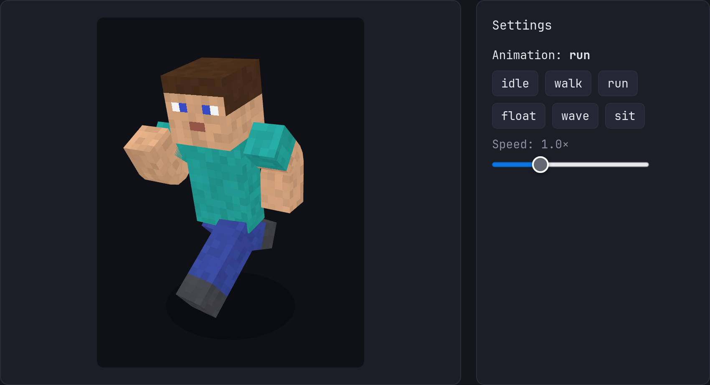

# 🧊 Minevo3D

**The 3D Minecraft character viewer with real bendable arms and legs. Drop it into any web app in one line of code.**

Elbows & knees that actually bend · Skins · Capes · Animations · Camera · Lighting — built on [three.js](https://threejs.org), with first-class React support and zero asset downloads.

[](https://www.npmjs.com/package/minevo3d)
[](#-license)
[](https://www.typescriptlang.org)
[](https://threejs.org)
[](https://react.dev)



---

## ✨ Why Minevo3D?

Showing a Minecraft player in 3D on your website normally means wiring up three.js by hand: building the body parts, mapping skin UVs, handling slim arms, writing animation math, and managing cameras and lights. **Minevo3D does all of that for you.**

```tsx
import { ReactMinevo3D } from 'minevo3d/react';

<ReactMinevo3D skin="https://example.com/skin.png" animation="walk" />
```

That's it. You get a rigged, animated, draggable character.

### 🦴 Limbs that actually bend

Most Minecraft viewers treat arms and legs as **stiff, rigid blocks**. They can swing from the shoulder or hip, but they can never fold, so waving, sitting, kneeling, and running all end up looking like a mannequin.

Minevo3D is different. **Every arm and leg is a two-segment skinned mesh with a real elbow or knee joint**, and the skin is smoothly blended across the bend so the texture stays continuous instead of showing a hard seam. That means natural-looking poses out of the box:

```tsx
// An arm raised and bent at the elbow, a knee bent into a sitting pose
<ReactMinevo3D pose={{ armR: { forward: 90, bend: 90 }, legL: { forward: 90, bend: 90 } }} />
```

| | Rigid-limb viewers | **Minevo3D** |
| --- | --- | --- |
| Elbow and knee bend | ❌ | ✅ |
| Natural walk / run cycle | Stiff swinging | Knees and elbows flex |
| Sitting, kneeling, waving | Looks wrong | Looks right |
| Smooth skin across the joint | n/a | ✅ Adjustable with `blendWidth` |

### Everything you need

| | |
| --- | --- |
| 🦴 **Real elbows & knees** | Every limb bends at the joint with smooth skin blending, so `walk`, `run`, `sit`, and `wave` look natural instead of stiff. |
| 🎨 **Every skin format** | Modern `64×64`, legacy `64×32`, and HD skins (`128`, `256`, `512`…) with automatic slim (Alex) arm detection. |
| 🦸 **Capes with real motion** | Standard `64×32`, compact `22×17`, and HD capes, with spring-based secondary motion so the cape lags and bounces naturally. |
| 🏃 **Built-in animations** | `idle`, `walk`, `run`, `float`, `wave`, `sit`. Cross-fade between them automatically. |
| 🛠 **Make your own animations** | Write a plain function, use keyframes, or combine existing animations. |
| 🎥 **Cinematic camera** | Zoom, FOV, orbit, dolly-zoom, camera shake, and smooth animated transitions. |
| 🔄 **Auto-rotate** | A turntable that pauses while the user drags and resumes afterward. |
| 💡 **Flexible lighting** | World light, camera headlight, or a cheap unlit mode for lists with many characters. |
| 🧩 **React or vanilla** | `minevo3d/react` gives you a ready-made `<ReactMinevo3D />` component *and* a framework-free `CharacterViewer` class. |
| 📦 **No asset files** | The default skin and cape are generated in code, so there is nothing extra to host. |
| 🔒 **Typed end to end** | Written in strict TypeScript. Every option and handle method has types and docs. |

---

## 📦 Installation

Minevo3D treats `three` and `react` as peer dependencies, so you stay in control of their versions.

```bash
# npm
npm install minevo3d three

# pnpm
pnpm add minevo3d three

# yarn
yarn add minevo3d three
```

Using the React component? Also install React:

```bash
# npm
npm install react

# pnpm
pnpm add react

# yarn
yarn add react
```

**Requirements:** `three >= 0.185.1`. `react >= 18` is only needed for `minevo3d/react`. TypeScript users should also install `@types/three`.

---

## 🚀 Quick start

### React

```tsx
import { ReactMinevo3D } from 'minevo3d/react';

export function Player() {
    return (
        // The viewer fills its parent, so give the parent a size.
        <div style={{ width: 320, height: 420 }}>
            <ReactMinevo3D />
        </div>
    );
}
```

Add your own skin, cape, and animation:

```tsx
<ReactMinevo3D
    skin="/skins/steve.png"
    cape="/capes/migrator.png"
    animation="walk"
    autoRotate
/>
```

### Vanilla JavaScript / TypeScript

```ts
import { CharacterViewer } from 'minevo3d';

const container = document.querySelector<HTMLElement>('#character')!;

const viewer = new CharacterViewer(container, {
    skin: '/skins/steve.png',
    animation: 'run',
    autoRotate: true,
});

// Clean up when the element is removed.
viewer.dispose();
```

> **Note:** Remote skin and cape URLs must allow CORS requests.

---

## 📖 Guide

### 🎨 Skins

A skin can be a **URL, `File`, `Blob`, ``, `<canvas>`, or `ImageBitmap`**, so loading from an upload input is easy.

```tsx
<ReactMinevo3D skin={fileFromInput} />
```

- Classic and slim (Alex) arms are detected automatically. Force one with `armModel="classic" | "slim"`.
- Legacy `64×32` skins work too (left limbs are mirrored from the right).
- HD skins keep their resolution. Control texture filtering with `skinFilter="auto" | "nearest" | "smooth"`.
- Hide the outer layer (hat, jacket, sleeves, trousers) with `showOverlay={false}`.
- Changing the `skin` prop keeps the current animation going. Use `resetOnSkinChange` if you want it to restart.

### 🦸 Capes

```tsx
<ReactMinevo3D
    cape="/capes/cape.png"        // or `true` for the built-in cape, `null` to hide
    capePhysics={{ stiffness: 60, damping: 7, gravity: 0.7 }}
    onCapeLoad={info => console.log(info.format, info.scale)}
/>
```

The cape reacts to body movement through a damped spring simulation. You can also drive it from your own animations through the pose's `cape` channel (`swing`, `bend`, `sway`). Set `capePhysics={false}` to turn the simulation off.

### 🦴 Bendable limbs

Each arm and leg takes four values, so you can pose them like a real body:

| Value | Meaning |
| --- | --- |
| `forward` | Raise forward from the shoulder or hip (`0` = hanging, `90` = horizontal) |
| `out` | Swing sideways away from the body (`90` = horizontal, above `90` = overhead) |
| `bend` | Bend the **elbow** (arm) or **knee** (leg) |
| `bendIn` | Fold the lower segment toward or away from the body |

```tsx
<ReactMinevo3D
    pose={{
        armL: { forward: 58, out: 11, bend: 115, bendIn: 17 }, // hand up near the face
        legR: { forward: 40, out: 25, bend: 60 },              // relaxed, bent knee
    }}
/>
```

Control how soft the joint looks with `blendWidth`. Smaller values give a sharper, blockier fold, and larger values give a smoother one (default `1.5`):

```tsx
<ReactMinevo3D blendWidth={0.5} />   // crisp, blocky joints
<ReactMinevo3D blendWidth={2.5} />   // soft, rounded joints
```

The built-in `walk` and `run` animations use these joints too, flexing the knees and elbows on every step. Ready-made poses like `POSE_SITTING` and `POSE_FLOATING` are exported for you to reuse.

### 🏃 Animations

Built-in names: `'idle' | 'walk' | 'run' | 'float' | 'wave' | 'sit'`

```tsx
<ReactMinevo3D animation="wave" animationSpeed={1.2} intensity={0.8} transition={0.3} />
```

**Write your own.** An animation is just a function that returns a partial pose:

```tsx
import { combineAnimations, walk, type AnimationFn } from 'minevo3d';
import { ReactMinevo3D } from 'minevo3d/react';

const nod: AnimationFn = ({ time, intensity }) => ({
    head: { pitch: Math.sin(time * 4) * 15 * intensity },
});

// Define it outside your component so its identity stays stable.
const walkAndNod = combineAnimations(walk, nod);

<ReactMinevo3D animation={walkAndNod} />
```

**Keyframes:**

```ts
import { createKeyframeAnimation } from 'minevo3d';

const dance = createKeyframeAnimation({
    duration: 1.2,
    ease: 'easeInOut',
    keyframes: [
        { time: 0,   pose: { armL: { out: 120, bend: 20 }, armR: { out: 30, bend: 10 } } },
        { time: 0.6, pose: { armL: { out: 30, bend: 10 }, armR: { out: 120, bend: 20 } } },
    ],
});
```

**Named registry:**

```tsx
<ReactMinevo3D animations={{ dance, fastWalk }} animation="dance" />
```

Also available: `createWalkAnimation`, `createRunAnimation`, `createFloatAnimation`, `createWaveAnimation`, `createDollyZoomAnimation`, `createCameraShake`, and `createCameraKeyframeAnimation`.

### 🎯 Pose overrides (e.g. head follows the mouse)

Pose overrides sit on top of whatever animation is playing. Using a `ref` means mouse movement never triggers a React re-render.

```tsx
import { useRef } from 'react';
import { ReactMinevo3D, type ReactMinevo3DHandle } from 'minevo3d/react';

export function LookAtMouse() {
    const viewer = useRef<ReactMinevo3DHandle>(null);

    return (
        <div
            style={{ width: 320, height: 420 }}
            onPointerMove={e => {
                const b = e.currentTarget.getBoundingClientRect();
                const x = ((e.clientX - b.left) / b.width) * 2 - 1;
                const y = ((e.clientY - b.top) / b.height) * 2 - 1;
                viewer.current?.setPose({ head: { yaw: x * 45, pitch: y * 25 } });
            }}
            onPointerLeave={() => viewer.current?.setPose(undefined)}
        >
            <ReactMinevo3D ref={viewer} camera={{ azimuth: 0 }} controls={false} />
        </div>
    );
}
```

### 🎥 Camera & controls

```tsx
<ReactMinevo3D
    camera={{ distance: 62, azimuth: 40, polar: 72, minZoom: 0.3, maxZoom: 5 }}
    fov={40}
    zoom={1.5}
    cameraTransition={{ duration: 0.8, ease: 'easeInOut' }}  // animate zoom/fov prop changes
    controls={{ rotate: true, zoom: true, resetOnDoubleClick: true }}
    autoRotate={{ speed: 20, resumeDelay: 2, pauseOnHover: true }}
/>
```

By default users can **drag to rotate**, while scroll-zoom is **off** so it never hijacks page scrolling. Enable it with `controls={{ zoom: true }}`.

Animate the camera from code:

```ts
viewer.current?.animateCamera({ zoom: 3, azimuth: 0 }, { duration: 1, ease: 'easeInOut' });
viewer.current?.resetCamera({ duration: 0.6 });
```

### 💡 Lighting

```tsx
<ReactMinevo3D
    globalLight={{ ambient: 0.7, directional: 0.45, position: [20, 40, 30] }}
    cameraLight                 // headlight that follows the camera
    shading="auto"              // 'auto' | 'lit' | 'unlit'
/>
```

With `shading="auto"`, turning off all lights switches the character to a cheap **unlit** mode, which is ideal when rendering many characters at once.

### 🧰 Imperative handle (`ref`)

```tsx
const viewer = useRef<ReactMinevo3DHandle>(null);

viewer.current?.play('run', { transition: 0.15 });
await viewer.current?.setSkin(newSkin);
await viewer.current?.setCape(null);          // hide cape
const png = viewer.current?.screenshot();     // PNG data URL
```

| Method | What it does |
| --- | --- |
| `play(animation, options?)` | Switch animation with a cross-fade |
| `setPose(partialPose)` | Override joints on top of the current animation |
| `setSkin(source, options?)` / `setCape(source, options?)` | Change the skin or cape; the old one stays visible until the new one loads |
| `animateCamera(target, options?)` / `resetCamera(options?)` | Animate or reset the camera |
| `fovTo(fov)` / `stopCameraAnimation()` | Camera shorthands |
| `setGlobalLight` / `setCameraLight` / `setShading` | Change lighting at runtime |
| `setAutoRotate` / `startAutoRotate` / `stopAutoRotate` | Control the turntable |
| `screenshot(type?, quality?)` | Capture the canvas as a data URL |
| `getRig()` / `getViewer()` | Access the character rig or the underlying three.js viewer |

### 🧩 Attach your own 3D objects

Need a sword in the hand or a floating item? Read joint positions every frame and move your own three.js objects with them.

```tsx
<ReactMinevo3D
    animation="float"
    onReady={handle => handle.getViewer()?.scene.add(myMesh)}
    onFrame={({ viewer }) => {
        const hand = viewer.rig.getJointWorldPosition('armR', 'end');
        myMesh.position.set(hand.x, hand.y + 2.6, hand.z);
    }}
/>
```

---

## 🧾 React props reference

| Group | Props |
| --- | --- |
| **Appearance** | `skin`, `skinFilter`, `armModel`, `showOverlay`, `blendWidth`, `background`, `shadow`, `grid`, `wireframe`, `showBones` |
| **Cape** | `cape`, `capePhysics`, `resetOnCapeChange` |
| **Animation** | `animation`, `animationKey`, `animations`, `animationSpeed`, `intensity`, `transition`, `pose`, `paused` |
| **Camera** | `camera`, `fov`, `zoom`, `cameraTransition`, `autoRotate`, `controls` |
| **Lighting** | `globalLight`, `cameraLight`, `shading` |
| **Layout** | `className`, `style`, `alt`, `maxPixelRatio` |
| **Events** | `onReady`, `onFrame`, `onCameraChange`, `onSkinLoad`, `onCapeLoad` |

All of them are fully typed and documented inline, so your editor will show you the details as you type.

---

## 🧭 Coordinate system

Handy when writing custom poses:

- **1 unit = 1 skin pixel.** The character is **32 units tall**, with feet at `y = 0`.
- All angles are in **degrees**.
- The character faces **+z**, and its **left** side is **+x**.
- Each arm and leg takes `{ forward, out, bend, bendIn }`. The head, torso, and whole body take `{ pitch, yaw, roll }`.

---

## 🧪 Run the examples locally

The repo ships with **21 interactive examples** (skins, capes, animations, camera, lighting, and more), each with copy-paste code for both React and vanilla JS.

```bash
git clone https://github.com/DryanFTH/Minevo3D.git
cd Minevo3D
pnpm install
pnpm dev
```

---

## 🛠 Development

```bash
pnpm typecheck        # type-check the library
pnpm build            # build the package into dist/
pnpm build:example    # build the examples site
pnpm format           # format with Prettier
```

---

## 🤝 Contributing

Contributions, bug reports, and ideas are very welcome!

1. Fork the repo and create a branch: `git checkout -b feat/my-idea`
2. Make your changes and run `pnpm typecheck && pnpm format`
3. Open a pull request describing what you changed and why

If Minevo3D is useful to you, a ⭐ on the repo helps other developers find it. Thank you!

---

## 📄 License

Released under the **[MIT License](./LICENSE)**. You're free to use Minevo3D in personal and commercial projects.

---

Minevo3D is an independent open-source project and is not affiliated with, endorsed by, or associated with Mojang Studios or Microsoft. "Minecraft" is a trademark of Mojang Studios.
